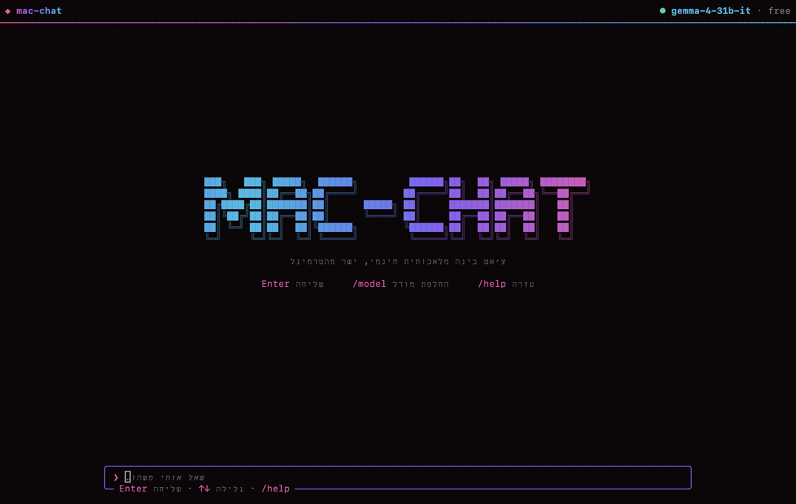
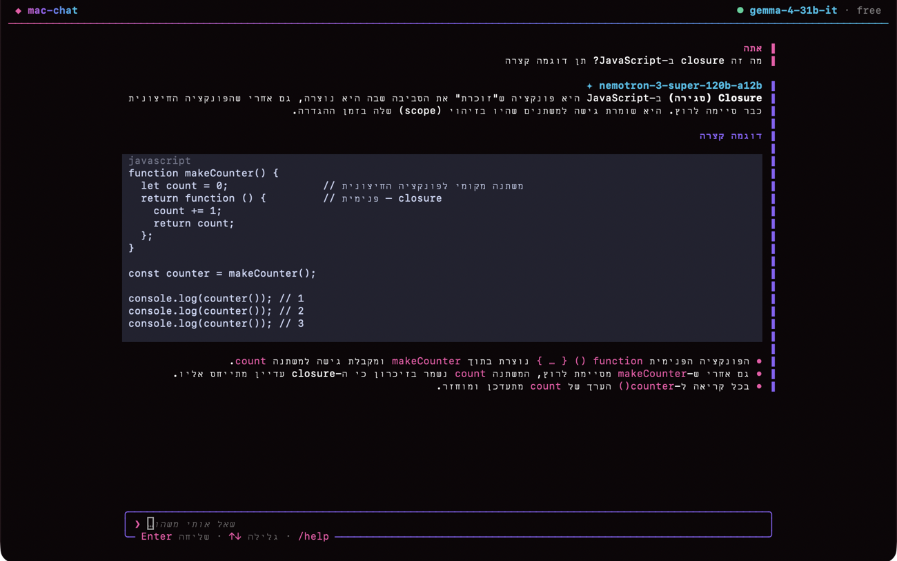

<div dir="rtl">

# mac-chat

צ׳אט בינה מלאכותית חינמי, ישר מהטרמינל של המק.
מסך מלא ונקי, בלי היסטוריית גלילה, עם מודלים חינמיים של [OpenRouter](https://openrouter.ai).

> **רק ל-macOS.** הכלי משתמש ב-Keychain, בחלונות של macOS וב-`pbcopy`.





## מה יש בו

- **מסך מלא בלי היסטוריה:** הצ׳אט רץ על מסך נפרד של הטרמינל. ביציאה הטרמינל חוזר בדיוק למצב שבו היה.
- **חינמי:** ברירת המחדל היא `gemma-4-31b` החינמי. אם הוא עמוס, הצ׳אט עובר לבד למודל חינמי אחר.
- **עברית מימין לשמאל:** הודעות בעברית מיושרות לימין ונקראות נכון, גם כשיש בהן מילים באנגלית.
- **תשובות בזמן אמת:** התשובה נכתבת תוך כדי, עם עיצוב לכותרות, רשימות, **הדגשות** ובלוקי קוד.
- **המפתח שמור ב-Keychain:** בהפעלה הראשונה נפתח חלון של macOS להזנת המפתח. המפתח לא נשמר בשום קובץ.
- **בלי תלויות:** קובץ Node אחד, בלי `npm install`.

## דרישות

- macOS
- [Node.js](https://nodejs.org) גרסה 18 ומעלה (`brew install node`)
- מפתח API חינמי של OpenRouter: [openrouter.ai/keys](https://openrouter.ai/keys)

## התקנה

```bash
git clone https://github.com/shmuelr16/mac-chat.git ~/mac-chat
~/mac-chat/install.sh
```

ההתקנה יוצרת שתי פקודות: `ai` ו-`mac-chat`. פתח טאב חדש בטרמינל והקלד:

```bash
ai
```

בהפעלה הראשונה נפתח חלון להדבקת המפתח. לחיצה על "קבלת מפתח…" פותחת את האתר של OpenRouter. המפתח נבדק ונשמר ב-Keychain.

אפשר גם לשאול ישר מהשורה:

```bash
ai "מה זה closure ב-JavaScript?"
```

## שימוש

| פקודה | מה היא עושה |
|---|---|
| `/new` | שיחה חדשה |
| `/model` | בחירת מודל חינמי מהרשימה |
| `/copy` | העתקת התשובה האחרונה |
| `/key` | החלפת מפתח ה-API |
| `/help` | עזרה |
| `/exit` | יציאה |

| מקש | פעולה |
|---|---|
| Enter | שליחה |
| Ctrl+J | שורה חדשה |
| ↑ ↓ או הגלגלת | גלילה בשיחה |
| PgUp / PgDn | גלילה בעמוד שלם |
| Tab | השלמת פקודה |
| Esc | עצירת תשובה |
| Ctrl+L | שיחה חדשה |
| Ctrl+C | יציאה |

## בעיות נפוצות

- **"המודל החינמי עמוס"**: למודלים חינמיים יש מגבלת קצב ומכסה יומית. חכה רגע או בחר מודל אחר עם `/model`.
- **שגיאת privacy או data policy**: צריך לאפשר מודלים חינמיים ב-[הגדרות הפרטיות של OpenRouter](https://openrouter.ai/settings/privacy).
- **`ai` מריץ משהו אחר**: כנראה יש לך alias או פונקציה בשם `ai` ב-`~/.zshrc`. הרץ `mac-chat` במקום, או שנה את השם שם.

## הסרה

```bash
rm /usr/local/bin/ai /usr/local/bin/mac-chat
security delete-generic-password -s mac-chat -a openrouter
rm -rf ~/.config/mac-chat ~/mac-chat
```

</div>

---

### English

A fullscreen, history-free terminal chat for **macOS only**, using free [OpenRouter](https://openrouter.ai) models. It is a single Node.js file with no dependencies. The API key is entered in a native macOS dialog and stored in the Keychain. The interface is in Hebrew, with right-to-left rendering.

```bash
git clone https://github.com/shmuelr16/mac-chat.git ~/mac-chat && ~/mac-chat/install.sh
ai
```

Requires Node.js 18+ and a free key from [openrouter.ai/keys](https://openrouter.ai/keys).

## License

MIT
